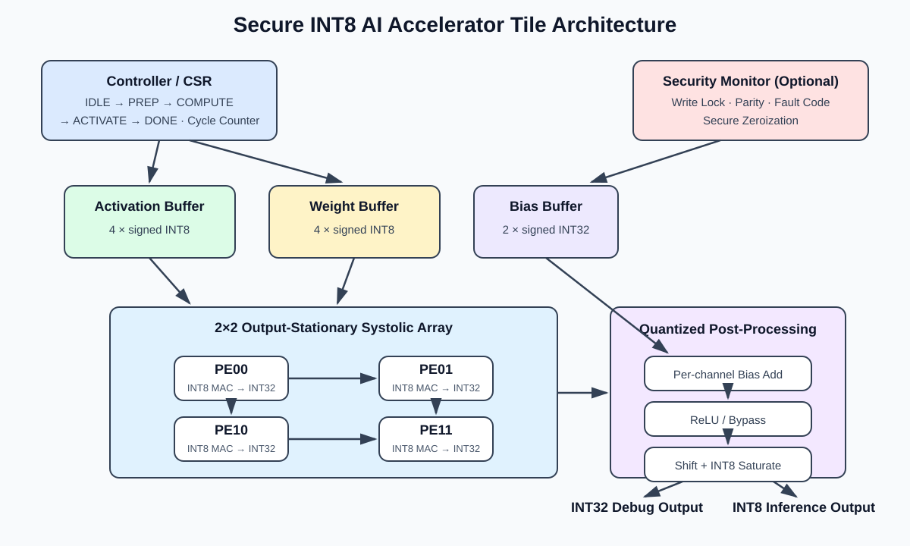
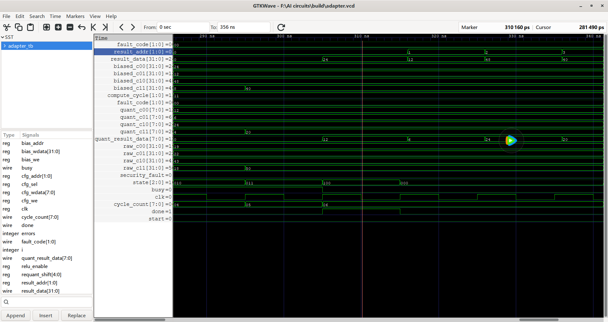

# SystolicGuard — Secure INT8 AI Accelerator Tile

## 项目介绍

**SystolicGuard** 是一个面向神经网络量化推理的可综合、可验证小型 AI 加速器 Tile。核心计算单元为 2×2 INT8 脉动阵列，支持有符号矩阵乘法、按输出通道 Bias、ReLU/旁路、定点重缩放与 INT8 饱和，并同时提供 INT32 调试结果和 INT8 推理结果。

项目覆盖 RTL 设计、测试平台、Python/PyTorch 黄金模型适配及 Yosys 综合，形成从算法参考、位精度验证到硬件实现与资源评估的完整闭环。配置侧还加入了非法写入检测、存储奇偶校验和安全清除，用于演示轻量级硬件安全机制。



[技术路线](#技术路线) · [复现流程](#复现流程) · [实验结果](#实验结果) · [完整架构说明](docs/architecture.md)

## 技术路线

### 1. 数据格式与计算目标

输入激活和权重采用 signed INT8，以降低存储、带宽和乘法器开销；单次乘法扩展为 signed INT16，部分和使用 signed INT32，避免多项累加过早溢出。计算目标为一个带按通道 Bias 和量化后处理的 2×2 矩阵乘法：

```text
acc[i,j]    = Σ A[i,k] × W[k,j]
biased[i,j] = acc[i,j] + bias[j]
C32[i,j]    = ReLU_or_bypass(biased[i,j])
C8[i,j]     = saturate_INT8(ReLU_or_bypass(biased[i,j] >>> shift))
```

`C32` 用于观察未经截断的完整结果，`C8` 可直接作为下一层量化推理的输入。实现入口见 [`rtl/ai_accelerator_top.v`](rtl/ai_accelerator_top.v)。

### 2. PE 微结构

每个 Processing Element 包含一个 8×8 有符号乘法器、一个 32 位累加器，以及激活/权重传递寄存器。使能有效时，PE 一边执行 `acc ← acc + A × W`，一边将 A 向右、W 向下传递；清零信号用于任务开始前复位流水线和部分和。具体实现见 [`rtl/mac_pe.v`](rtl/mac_pe.v)。

### 3. 2×2 Output-Stationary 脉动阵列

4 个 PE 组成 2×2 阵列，采用 output-stationary 数据流：每个输出元素的部分和始终保留在对应 PE 内，减少部分和在阵列中的搬运。第二行激活和第二列权重延迟一个周期注入，使配对数据在正确时钟到达同一个 PE。阵列连接见 [`rtl/systolic_array_2x2.v`](rtl/systolic_array_2x2.v)。

| COMPUTE 周期 | row0 输入 | row1 输入 | col0 输入 | col1 输入 | 作用 |
|---:|---:|---:|---:|---:|---|
| 0 | A00 | 0 | W00 | 0 | 启动左上角 PE |
| 1 | A01 | A10 | W10 | W01 | 主体数据进入阵列 |
| 2 | 0 | A11 | 0 | W11 | 注入最后一组数据 |
| 3 | 0 | 0 | 0 | 0 | 排空流水线 |

### 4. 本地缓冲与配置通路

顶层内置 4×INT8 激活缓冲、4×INT8 权重缓冲和 2×INT32 Bias 缓冲。软件通过 `cfg_we/cfg_sel/cfg_addr` 写入激活或权重，通过独立 Bias 端口写入两个输出通道的偏置；计算启动时锁存 `relu_enable` 和 `requant_shift`，保证任务执行期间配置稳定。接口和缓冲逻辑位于 [`rtl/ai_accelerator_top.v`](rtl/ai_accelerator_top.v)。

### 5. 量化后处理链路

阵列输出先加按输出列共享的 Bias，再经过可旁路 ReLU。INT32 路径保留完整激活结果；INT8 路径执行可配置算术右移，并将结果饱和到 `[-128, 127]`。ReLU 与重量化分别由 [`rtl/relu.v`](rtl/relu.v) 和 [`rtl/requantize_int8.v`](rtl/requantize_int8.v) 实现。

### 6. 控制状态机与周期

控制器采用 `IDLE → PREP → COMPUTE → ACTIVATE → DONE` 五状态流程：

| 状态 | 周期数 | 主要操作 |
|---|---:|---|
| `IDLE` | — | 装载激活、权重、Bias 和量化参数 |
| `PREP` | 1 | 清空 PE 流水寄存器与累加器 |
| `COMPUTE` | 4 | 错位注入、并行 MAC 与流水排空 |
| `ACTIVATE` | 1 | Bias、ReLU、重量化、饱和及结果写回 |
| `DONE` | 1 个脉冲 | 通知外部结果可读并返回空闲态 |

从 `PREP` 到结果写回共 6 个内部周期；4 个 PE 的峰值吞吐为 4 MAC/周期。状态机和 `cycle_count` 见 [`rtl/ai_accelerator_top.v`](rtl/ai_accelerator_top.v)。

### 7. 轻量安全机制

计算期间的配置写入会被阻止并记录 `FAULT_ILLEGAL_WRITE`；激活、权重和 Bias 写入时同步保存奇偶校验，启动前若检测到内容被篡改则记录 `FAULT_INTEGRITY` 并拒绝执行；`secure_clear` 可清空缓冲、输出、流水线和故障状态。机制边界见 [`docs/security.md`](docs/security.md)，实现仍位于 [`rtl/ai_accelerator_top.v`](rtl/ai_accelerator_top.v)。

### 8. 软硬件验证闭环

[`scripts/golden_model.py`](scripts/golden_model.py) 提供纯 Python 参考模型和 1000 组随机范围检查；[`software/architecture_adapter.py`](software/architecture_adapter.py) 使用 PyTorch CPU/CUDA（未安装 PyTorch 时回退纯 Python）生成位精确参考结果与 RTL 输入向量；[`tb/adapter_tb.v`](tb/adapter_tb.v) 读取向量并比较 RTL 输出；[`tb/ai_accelerator_tb.v`](tb/ai_accelerator_tb.v) 覆盖定向、随机、饱和和安全测试；最后由 [`scripts/synth_yosys.ys`](scripts/synth_yosys.ys) 完成层次检查、通用逻辑综合和资源统计。

## 复现流程

### 1. 获取项目

```bash
git clone https://github.com/zkhong-kkk/SystolicGuard-Secure-INT8-AI-Accelerator-Tile.git
cd SystolicGuard-Secure-INT8-AI-Accelerator-Tile
```

准备 Python 3、Icarus Verilog（`iverilog`/`vvp`）和 Yosys，并确保它们已加入 `PATH`。PyTorch 为可选依赖；没有 PyTorch 时，适配器会自动使用纯 Python CPU 参考模型。

### 2. 运行软件黄金模型

点击查看 [`scripts/golden_model.py`](scripts/golden_model.py)，然后执行：

```bash
python scripts/golden_model.py
```

预期输出：`PASS golden model: directed case + 1000 randomized cases`。

### 3. 运行完整 RTL 回归

测试入口为 [`tb/ai_accelerator_tb.v`](tb/ai_accelerator_tb.v)。根据系统选择一键脚本：

- Windows PowerShell：[`scripts/run_sim.ps1`](scripts/run_sim.ps1)
- Linux/macOS/WSL：[`scripts/run_sim.sh`](scripts/run_sim.sh)

```powershell
# Windows
.\scripts\run_sim.ps1
```

```bash
# Linux/macOS/WSL
bash scripts/run_sim.sh
```

终端应显示 `ALL TESTS PASSED`，并在本地生成 `build/ai_accelerator.vcd` 波形文件。

### 4. 复现算法到 RTL 的位精度对比

向量生成器为 [`software/architecture_adapter.py`](software/architecture_adapter.py)，RTL 文件驱动测试台为 [`tb/adapter_tb.v`](tb/adapter_tb.v)。一键脚本：

- Windows PowerShell：[`scripts/run_adapter.ps1`](scripts/run_adapter.ps1)
- Linux/macOS/WSL：[`scripts/run_adapter.sh`](scripts/run_adapter.sh)

```powershell
# 默认示例
.\scripts\run_adapter.ps1

# 自定义输入
.\scripts\run_adapter.ps1 --a "1,-2,-3,4" --b "5,6,-7,8" --bias "0,0" --shift 0 --no-relu
```

脚本会生成 `build/adapter_vectors.hex` 与 `build/adapter.vcd`，并逐项检查 C32/C8 是否与软件参考结果一致。仓库内的示例截图可直接查看：[`docs/adapter_waveform.png`](docs/adapter_waveform.png)。

### 5. 运行 Yosys 综合

综合流程定义在 [`scripts/synth_yosys.ys`](scripts/synth_yosys.ys)，根据系统选择：

- Windows PowerShell：[`scripts/run_synth.ps1`](scripts/run_synth.ps1)
- Linux/macOS/WSL：[`scripts/run_synth.sh`](scripts/run_synth.sh)

```powershell
# Windows
.\scripts\run_synth.ps1
```

```bash
# Linux/macOS/WSL
bash scripts/run_synth.sh
```

完成后会在本地生成 `build/synthesis_report.txt` 和 `build/ai_accelerator.json`。综合后的模块对应关系与性能分析可继续阅读 [`docs/architecture.md`](docs/architecture.md)，设计取舍见 [`docs/design.md`](docs/design.md)。

## 实验结果

### RTL 功能回归

使用 Icarus Verilog 运行测试平台，10 组测试全部通过，其中包含 20 组随机架构回归。测试范围如下：

| 测试类别 | 验证内容 | 结果 |
|---|---|---|
| 基础计算 | 2×2 矩阵乘法、signed INT8、ReLU 与旁路 | 通过 |
| 量化后处理 | 按通道 Bias、算术右移、正负 INT8 饱和 | 通过 |
| 随机回归 | 随机激活、权重、Bias、ReLU 和 shift，共 20 组 | 通过 |
| 安全机制 | 非法写入拦截、权重奇偶校验、`secure_clear` 清除 | 通过 |

仿真最终输出：

```text
TEST 7: 20 randomized architecture regressions
  PASS 20 randomized cases
TEST 8: illegal write attack is blocked and logged
  PASS illegal write blocked, fault_code=1
TEST 9: parity detects weight fault injection
  PASS weight tamper detected, execution refused
TEST 10: secure_clear zeroizes architectural state
  PASS secure zeroization complete
ALL TESTS PASSED
```

### 算法适配波形

下图展示了 Python/PyTorch 参考输入驱动 RTL 后的关键波形。示例配置为：

```text
A    = [1, 2; 3, 4]
W    = [5, 6; 7, 8]
bias = [5, -10]
shift = 1, ReLU = true

C32 = [24, 12; 48, 40]
C8  = [12,  6; 24, 20]
```

波形中 `cycle_count=6` 时 `done` 拉高，四个地址依次读出上述 INT32 与 INT8 结果，且 `security_fault=0`。



### Yosys 综合结果

以 `ai_accelerator_top` 为顶层进行 Yosys 通用逻辑综合，统计结果如下。该结果是综合后的通用 cell 数量，不等同于特定 FPGA 的 LUT/DSP 映射结果。

| 指标 | 数量 |
|---|---:|
| Cells | 351 |
| Multipliers (`$mul`) | 4 |
| Adders (`$add`) | 10 |
| Multiplexers (`$mux`) | 162 |
| 带使能触发器 (`$adffe`) | 45 |
| 算术右移单元 (`$sshr`) | 4 |
| Wires / Wire bits | 446 / 3891 |
